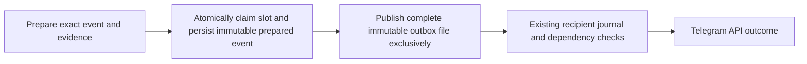

# November 3 evening — scheduled handoff failure assessment

## Changes

This bounded after-close assessment reproduces the reservation-to-outbox failure boundary using the existing scheduler, idea tick, storage and exclusive-file publisher on isolated synthetic data. It records a concrete protocol for the next implementation. **No handoff correction has been implemented or deployed.** The event-date correction remains the deployed release, with its earlier 953 portable / 942 installed complete checks retained; those suites were not repeated here.

The real November 3 14:00 ET incident still has a durable slot reservation and composition row, but no expected retained outbox or owner acceptance journal. Adjacent monitor ticks recorded SQLITE_BUSY. The original incident has no statement-level stack trace, so its exact failing statement and complete causal chain remain unknown. The controlled fault below demonstrates a mechanism that can produce the same boundary; it does not retroactively supply the missing production stack trace.

## Verification

Five offline diagnostic cases executed the existing implementation with isolated memory, temporary SQLite/files, explicit fault injection and fake transport. All five produced their expected current failure/safety observations, with zero harness failures, errors or skips. This is a successful reproduction of current behavior, including a defect; it is not a corrected implementation, complete regression PASS, Telegram transport test or active-session qualification.

| Diagnostic | Observed current boundary |
|---|---|
| Actual idea tick: metadata write fails | Injecting an OperationalError at the scheduled `market_view` write leaves the slot RESERVED_NO_BLIND_RETRY before any fake transport call. A later successful evaluation in the same slot still emits nothing because the reservation exists. |
| Actual exclusive outbox writer: audit fails | The complete outbox file exists before the subsequent audit write fails. Calling the writer again with the same ID and changed text leaves the original bytes intact; pending temporary files are cleaned up. An exception therefore does not establish whether a handoff happened. |
| Publisher raises after its callback is entered | The reservation remains and the scheduler does not invoke that possibly completed callback again. This refusal must survive any recovery redesign. |
| SQLite lock prevents the reservation | A real temporary writer lock prevents reservation commit and prevents publication; after rollback no slot claim exists. This is different from failure after a successful reservation. |
| Old slot versus the next slot | A retained old reservation is unchanged. Only the next current slot gets its own stable ID, remains silent/private under the fixture preference, and no after-close old-slot backlog is emitted. |

The initial assessment preflight required raw operative/public bytes to match and stopped before copying or testing because some source files use different CRLF/LF encoding. A subsequent comparison verified that the four assessed modules were identical after line-ending normalization. The assessment then used their **exact operative bytes** in its isolated baseline. The failed preflight, both raw digests and the diagnostic logs remain private evidence. No operative file was normalized or edited, and no semantic source mismatch was waived.

## Proposed next implementation

Preparation should complete before the durable claim. The claim and complete canonical prepared event should then commit together in one bounded SQLite transaction, using an additive immutable event store and a versioned protocol. A successful claim must imply that the exact event payload, stable ID, original source/evaluation clocks, expiry, audience and dependency metadata are recoverably durable. A failed transaction must leave neither half committed.

Preparation, commit and publication delays must still be measured against the actual post-work clock and the existing current-slot, source/receipt, risk and publication gates. Original timestamps must remain unchanged. A durable prepared payload cannot acquire freshness by being read again or justify a new entry after its evidence expires.

Publication should exclusively expose those exact saved bytes as a complete outbox file. The existing notifier's exclusive per-recipient journal and parent-before-update checks remain the transport authority. Audit/projection work after publication must not erase or reinterpret the publication boundary. A published file or a failed callback is not API acceptance; an uncertain journal never becomes permission to send again.

A future recovery path must be restricted to newly versioned prepared records and their original current-slot/expiry boundaries. It must check matching outbox content, dispatch markers and owner/guest journals before any local file handoff. Existing accepted or uncertain journals, conflicting content, unreadable evidence, unknown legacy reservations and expired events must fail closed. It must never extend an expiry, retime source/evaluation clocks, recompose an old opportunity, clear an old reservation or infer handset delivery.

The existing November 3 14:00 legacy reservation lacks such a prepared-event protocol and must remain ineligible for automatic recovery. This plan does not authorize backfilling that message or reconstructing its historical publication contents.

The implementation gate should include fault injection before and after transaction commit, process interruption between commit and file publication, exclusive file conflicts, post-link audit failure, competing local claims, expired/current-slot boundaries, legacy reservations, unreadable/malformed records, unknown delivery, owner and per-guest parent ordering, and actual scheduler integration. Required complete installed/portable verification and controlled loading remain prerequisites after a substantive code change. No synthetic result should be presented as genuine-session acceptance.

## Limitations

This is an assessment and a saved design checkpoint. It reduces uncertainty about failure boundaries without changing current service behavior. It does not establish that a particular metadata write caused the original production failure, prove crash recovery, eliminate SQLite contention, or repair the missing slot. The deployed date presentation fix also does not repair this gap.

The November 3 as-issued engineering FAIL remains: 24/25 owner statuses API-accepted, 19 timely, one missing slot, monitor p95 14.156 seconds and 200 failed ticks. Native coverage/composition PASS and three strict scheduled-analysis observations have different populations; one of those observations was the undelivered slot. Genuine option outcomes and strategy edge remain unestablished. No native report, issued packet or original market timestamp was rewritten.

IEX remains one-exchange underlying research. Quote/receipt freshness, skew, heartbeat, continuity, calendar, risk, option and live gates remain strict. No changing price/macro-event claim, new credential/entitlement probe, strategy change, Reddit/scanner/Questrade expansion or live promotion occurred. Private reported exposure and authenticated requests were reviewed locally without publishing their contents or inferring brokerage sale, settlement or exercise.

## Setup impact

None for the running application: no production source/configuration/schema/task/sharing change, service restart, manual Telegram send, guest development message or uncertain replay. Only this sanitized report and the current-status index are published. The evening assistant's stale checkpoint text is aligned with the completed date correction and this pending handoff assessment while its existing schedule, routing, status and notification preference are preserved; it remains separate from the single production scheduler. Full software suites were not repeated for this assessment; publication uses the release guard, staged whitespace review and exact remote verification.

Any future prepared-outbox implementation requires its own reviewed additive persistence/recovery procedure, verification report and source-only rollback plan that preserves later immutable events. No database rewind is authorized. Cost remains $0 incremental; all orders remain manual, live/execution flags and LIVE_SIGNAL_READY remain false, and BUY/SELL/TRADE_PROPOSAL kinds stay blocked. Windows must remain awake/online; periodic assistant checks are not continuous exit coverage.
